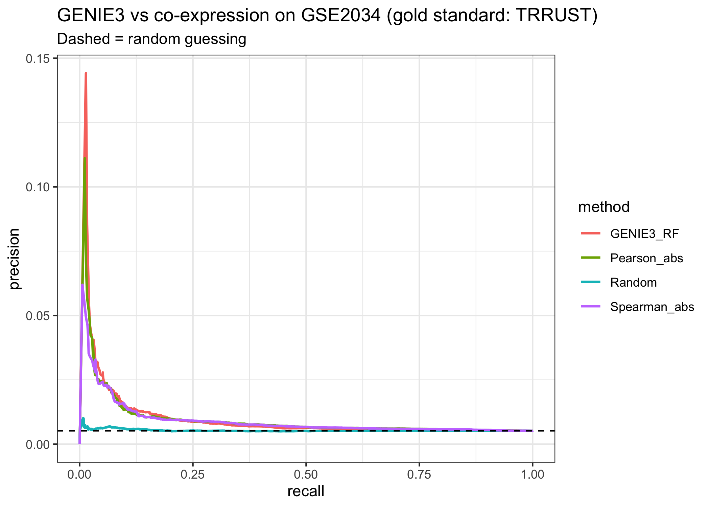
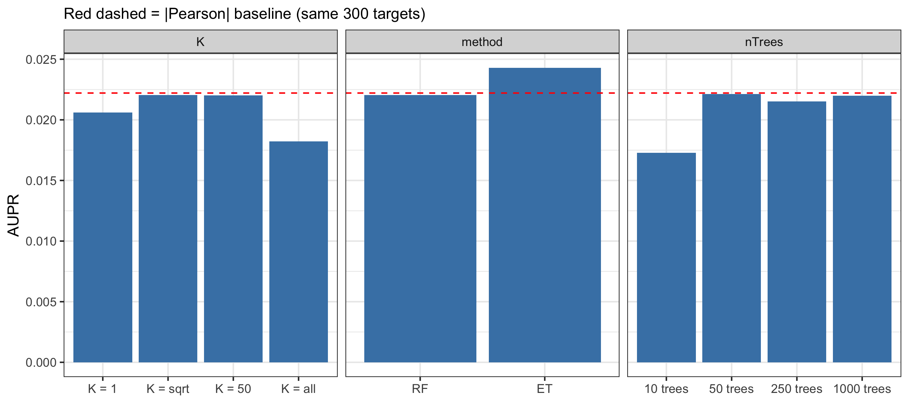
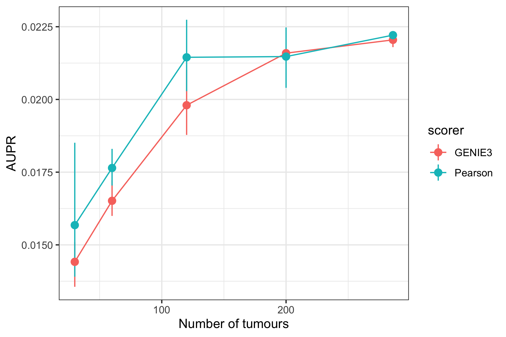

# Directed gene regulatory network inference in breast cancer with GENIE3

CB 5313 Systems Biology & Network Modeling, Course Project (Topic 6)
Sanjana Reddy

## Question
Can GENIE3 (Huynh-Thu et al., 2010) recover known transcription factor (TF) -> target
links from bulk breast tumour expression data, and does its non-linear, tree-based
approach outperform a simple correlation (co-expression) network taught in the course?

## Data
| Dataset | Description | Source |
|---|---|---|
| GSE2034 | 286 lymph-node-negative primary breast tumours, Affymetrix HG-U133A (GPL96) | NCBI GEO |
| TRRUST v2 (human) | 8,427 literature-curated TF -> target links (gold standard) | https://www.grnpedia.org/trrust/ |

Raw data are not committed. `scripts/01_download_data.R` downloads both.
If GEO times out, download `GSE2034_series_matrix.txt.gz` and `GPL96.annot.gz`
from GEO into `data/raw/` and rerun the script.

## How to run
Open `systems bio.Rproj` in RStudio, then:

```r
renv::restore()                          # install exact package versions
source("scripts/01_download_data.R")     # GEO + TRRUST download
source("scripts/02_preprocess.R")        # probe -> gene, filter, scale
source("scripts/03_run_genie3.R")        # main GENIE3 run (~1.5 min on 9 cores)
source("scripts/04_evaluate.R")          # GENIE3 vs correlation vs random
source("scripts/05_parameter_sweep.R")   # K, nTrees, RF/ET, sample size
```

| Script | In | Out |
|---|---|---|
| 02_preprocess.R | GEO ExpressionSet, TRRUST | 1000 genes x 286 tumours (log2, unit variance), 223 TF regulators, 1,155 gold-standard edges |
| 03_run_genie3.R | processed matrix | 223 x 1000 weight matrix, top-1000 edge list |
| 04_evaluate.R | weights + TRRUST | AUPR/AUROC table, PR curves, sign check, hub TFs |
| 05_parameter_sweep.R | processed matrix | sweep table + 2 plots |

## Methods summary
- Probes collapsed to genes (highest-mean probe), restricted to TRRUST genes, bottom 25%
  by mean expression removed, top 1000 by variance kept.
- Each gene scaled to unit variance, as in the paper.
- GENIE3: Random Forests, K = sqrt, 500 trees; only TRRUST TFs allowed as regulators
  (as in the paper's E. coli analysis).
- Evaluation: all 222,777 TF -> gene pairs scored; TRRUST links are positives (0.52%).
  Metrics: AUPR, AUROC, precision in the top 100 / 1000 edges.

## Changes beyond the tutorial
1. **Different dataset**: human breast tumours instead of DREAM4 / E. coli.
2. **Comparison with a course method**: |Pearson| and |Spearman| co-expression networks.
3. **Parameter sweep**: K (1, sqrt, 50, all), nTrees (10 to 1000), Random Forests vs Extra-Trees.
4. **Sample-size experiment**: 30 to 286 tumours, 3 random subsamples each.

## Results

### 1. GENIE3 vs correlation
| Method | AUPR | AUROC | Fold over random | Precision top 100 |
|---|---|---|---|---|
| GENIE3 (RF) | 0.0115 | 0.560 | 2.23x | 0.13 |
| abs(Pearson) | 0.0106 | 0.584 | 2.05x | 0.11 |
| abs(Spearman) | 0.0096 | 0.584 | 1.86x | 0.06 |
| Random | 0.0053 | 0.497 | 1.02x | 0.01 |



All methods beat random, but only at the very top of their rankings; beyond about
10% recall, every curve falls to the random baseline. GENIE3 has the highest early
precision (13 of its top 100 edges are known), yet it is only marginally better than
simple correlation overall, and correlation has a slightly higher AUROC. This suggests
that in bulk tumour data most of the recoverable regulatory signal is linear
co-expression, so GENIE3's ability to model non-linear effects adds little.

### 2. Hub regulators
Top hubs in the 1000 highest-ranked edges: IRF8, SNAI2, RUNX3, FOXM1, PTTG1, TNFAIP3,
GATA3, TCF4, IFI16, TRIM22, ESR1, EZH2, FOXA1 (`results/top_hubs.csv`).

The hubs fall into four programmes that are known to dominate variation between breast
tumours: immune infiltration (IRF8, RUNX3, TNFAIP3, IFI16, TRIM22), proliferation
(FOXM1, PTTG1, EZH2), the luminal/ER programme (GATA3, ESR1, FOXA1) and stroma/EMT
(SNAI2, TCF4). Most hub edges are not in TRRUST (IRF8: 64 edges, 1 confirmed). This
indicates that GENIE3 largely recovers *cell-type composition and tumour subtype*: IRF8
predicts immune genes because immune-cell content varies between tumours, not
necessarily because it regulates them inside tumour cells.

### 3. Direction and sign
| TRRUST mode | n | Correlation sign agrees |
|---|---|---|
| Activation | 363 | 66.9% |
| Repression | 241 | 43.2% |

GENIE3 weights are always non-negative, so the method cannot distinguish activation
from repression. Correlation sign recovers known activations better than chance, but
not repressions, possibly because many TRRUST repressions were described in other cell
types or conditions. Directionality is also limited: HOXC10 -> HOXC11 and HOXC11 -> HOXC10
are both in the top 3 edges. The strong MED1 -> STARD3 and MED1 -> ERBB2 edges reflect
co-amplification of the 17q12 (HER2) amplicon rather than regulation, a direct violation
of GENIE3's assumption that predictive genes are direct regulators.

### 4. Parameter sweep (300 targets with >= 1 known regulator)
| Setting | AUPR |
|---|---|
| K = 1 / sqrt / 50 / all | 0.0206 / 0.0221 / 0.0220 / 0.0182 |
| nTrees = 10 / 50 / 250 / 500 / 1000 | 0.0173 / 0.0221 / 0.0215 / 0.0221 / 0.0220 |
| Random Forests / Extra-Trees | 0.0221 / 0.0243 |
| abs(Pearson) on the same targets | 0.0222 |



K shows an inverted U: K = 1 is too random, K = all makes every tree choose the same
dominant regulators, and intermediate values (sqrt, 50) are best, matching the paper's
choice of RF-sqrt. Accuracy plateaus from about 50 trees, so 500 trees is sufficient.
On this target set, Random Forests GENIE3 only equals the Pearson baseline; only
Extra-Trees exceeds it. AUPRs here are not comparable to Section 1 (different target set),
and run-to-run noise at n = 286 is about +/- 0.0003.

### 5. Sample size
| Tumours | Mean AUPR, GENIE3 (3 subsamples) |
|---|---|
| 30 | 0.0144 |
| 60 | 0.0165 |
| 120 | 0.0198 |
| 200 | 0.0216 |
| 286 | 0.0221 |



Accuracy rises with sample size and levels off from about 200 tumours. Pearson
correlation is better than GENIE3 with 30-120 tumours, and the two converge at about 200.
A random forest must learn split points and so needs more data than a single correlation
coefficient; GENIE3's extra flexibility only pays off with large cohorts. Beyond about
200 samples, performance is limited mainly by the method's assumptions and the
incomplete gold standard, not by sample size.

## Limitations
- **Predictive is not regulatory**: co-amplified genes and cell-type mixing in bulk
  tissue create strong but non-regulatory edges.
- **No sign and no threshold**: the output is an unsigned ranking; the cut-off is arbitrary.
- **Incomplete gold standard**: TRRUST misses true links, so reported AUPR is a lower bound.
- **Gene selection**: restricting to the 1000 most variable TRRUST genes may favour
  highly variable programmes (immune, proliferation).
- **Software pitfall**: the GENIE3 R package silently treats an integer K (e.g.
  `as.integer(50)`) as "all". This was caught because three different K values gave
  identical results, and fixed by passing K as numeric.

## AI use disclosure
AI assistance (Claude, Anthropic) was used to help write and debug the R scripts,
to guide the reading and annotation of the paper, and to draft the synopsis and this
README, which I then reviewed and edited.

## References
- Huynh-Thu VA, Irrthum A, Wehenkel L, Geurts P (2010). Inferring regulatory networks
  from expression data using tree-based methods. PLoS ONE 5(9): e12776.
- Wang Y, et al. (2005). Gene-expression profiles to predict distant metastasis of
  lymph-node-negative primary breast cancer. Lancet 365: 671-679.
- Han H, et al. (2018). TRRUST v2: an expanded reference database of human and mouse
  transcriptional regulatory interactions. Nucleic Acids Res 46: D380-D386.